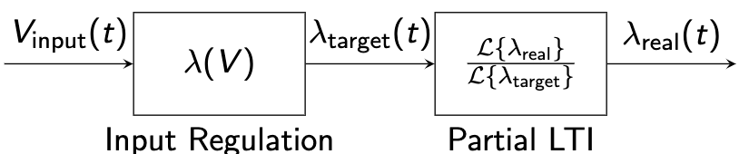

# General System Block Diagram

## Input Regulation

This is the frequency-independent part.

### Example: Thermal Phase Shifter

$$
\lambda_\text{target} = \frac{\text{FSR}}{P_\text{FSR}} \cdot \frac{V^2}{R}
$$

## Partial LTI

This is the frequency-dependent part. The LTI there must be with a DC gain of 1.
