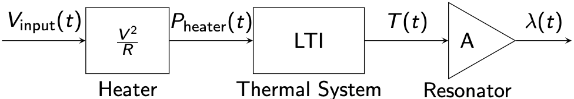
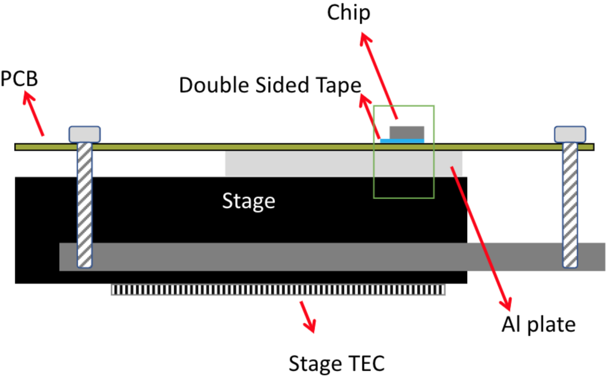
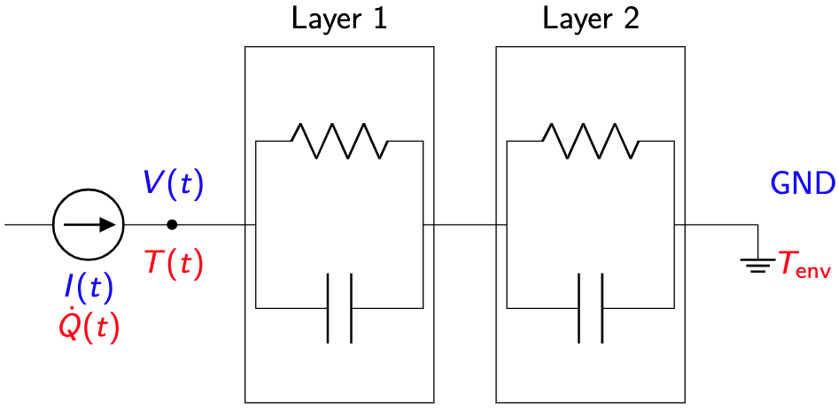

# Simplified Heat Transfer Model

## System Block Diagram

## LTI Thermal System Example: Heater on Chip

### Assumption

Heat transfer in this process is 1D pure conduction.

### Setup

### Heat Circuit

### LTI Parameters

The parameters can be measured in either:

- forwardly:
  - measure the thermal properties of the thermal mass layers and calculate the thermal resistance/capacitance
- reversely:
  - by data and observations from preliminary system identification experiments
