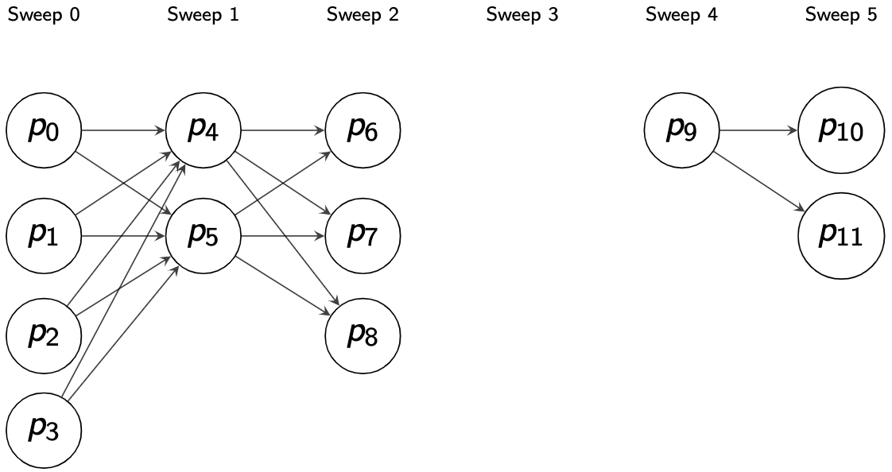

# Graph



There are actually two parts in the graph representation:

1. A 1D array storing all the peak vectors.
2. A 2D array (adjacency matrix) storing all the peak connections.

The graph 1D array uses a single subscript to locate a peak.

```python
peak = graph_1d_array[index]
```

The graph 2D adjacency matrix uses two subscripts to describe the connection between two peaks.

```python
connection = adjacency_matrix[peak1_index][peak2_index] # the cost from peak1 to peak2
connection = adjacency_matrix[peak2_index][peak1_index] # the cost from peak2 to peak1, if connection is directed
```
