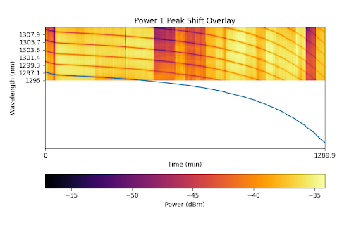
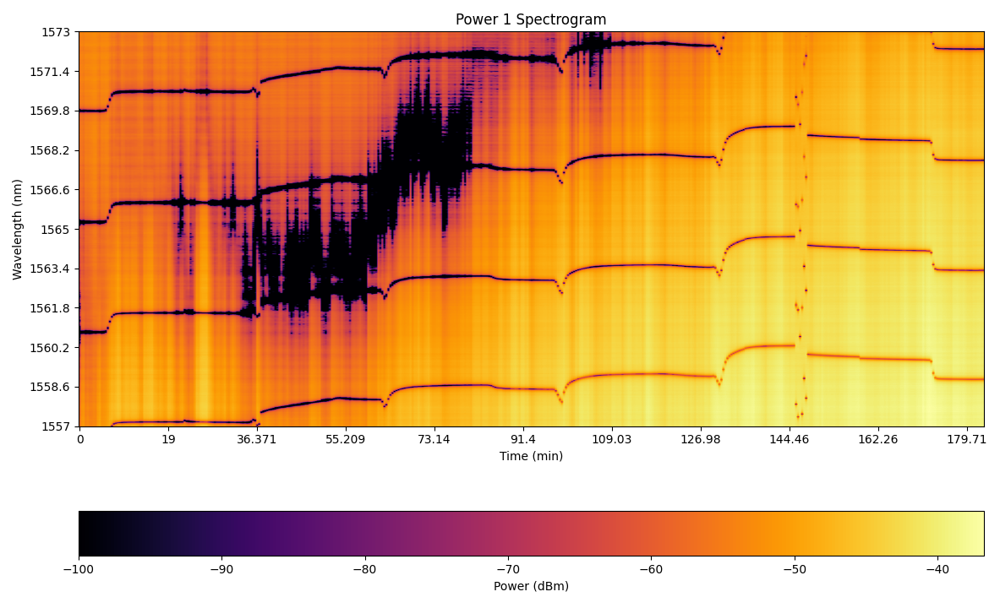

# Peak Tracking

Peak Tracking is tracking the peak central wavelength shift over time (over #sweep).

Because of the FSR feature of the resonator, the trace can be out of the sweep range.

Usually, the read dataset contains noises or unavailable peaks. The algorithm can:

- Compute the full-length overall peak shift trace;
- Or, compute a few trace sections, and decide their relative position later.

