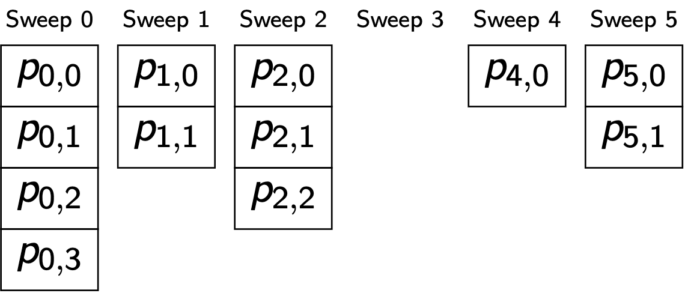

# Ragged Array



The ragged array representation uses two subscripts to locate a peak.

```python
peak = ragged_array[sweep_index][peak_index_in_sweep]
```

Notice that some sweeps may have no peaks at all.
